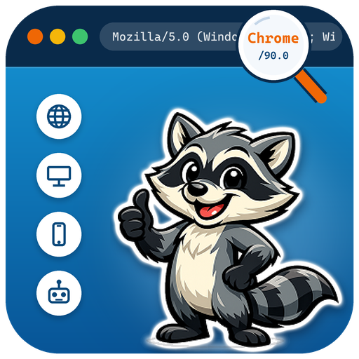
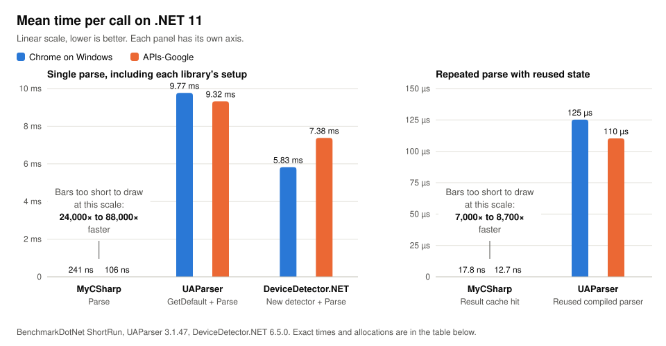

<div align="center">



# MyCSharp.HttpUserAgentParser

**Parsing HTTP User Agents with .NET**

Detects browsers, platforms, mobile devices and crawlers with low allocations.

[](https://github.com/mycsharp/HttpUserAgentParser/actions/workflows/main-build.yml)
[](Directory.Build.props)
[](https://www.nuget.org/packages/MyCSharp.HttpUserAgentParser)
[](https://www.nuget.org/packages/MyCSharp.HttpUserAgentParser)
[](LICENSE)

[](https://dotnet.microsoft.com/)
[](#native-aot-and-trimming)
[](#native-aot-and-trimming)
[](https://learn.microsoft.com/dotnet/standard/assembly/strong-named)
[](https://learn.microsoft.com/dotnet/standard/library-guidance/sourcelink)

[](https://github.com/mycsharp/HttpUserAgentParser/stargazers)
[](https://github.com/mycsharp/HttpUserAgentParser/commits/main)
[](https://github.com/mycsharp/HttpUserAgentParser/issues)

</div>

## NuGet

| Package | Version | Downloads | Install |
| --- | --- | --- | --- |
| **[MyCSharp.HttpUserAgentParser](https://www.nuget.org/packages/MyCSharp.HttpUserAgentParser)**<br><sub>Core parser</sub> | [](https://www.nuget.org/packages/MyCSharp.HttpUserAgentParser) | [](https://www.nuget.org/packages/MyCSharp.HttpUserAgentParser) | `dotnet add package MyCSharp.HttpUserAgentParser` |
| **[MyCSharp.HttpUserAgentParser.MemoryCache](https://www.nuget.org/packages/MyCSharp.HttpUserAgentParser.MemoryCache)**<br><sub>Caching with `IMemoryCache`</sub> | [](https://www.nuget.org/packages/MyCSharp.HttpUserAgentParser.MemoryCache) | [](https://www.nuget.org/packages/MyCSharp.HttpUserAgentParser.MemoryCache) | `dotnet add package MyCSharp.HttpUserAgentParser.MemoryCache` |
| **[MyCSharp.HttpUserAgentParser.AspNetCore](https://www.nuget.org/packages/MyCSharp.HttpUserAgentParser.AspNetCore)**<br><sub>ASP.NET Core integration</sub> | [](https://www.nuget.org/packages/MyCSharp.HttpUserAgentParser.AspNetCore) | [](https://www.nuget.org/packages/MyCSharp.HttpUserAgentParser.AspNetCore) | `dotnet add package MyCSharp.HttpUserAgentParser.AspNetCore` |

The NuGet packages target .NET 8, 9, 10, and 11. Building the solution requires the .NET 11 SDK.

## Usage

```csharp
string userAgent = "Mozilla/5.0 (Windows NT 10.0; Win64; x64) AppleWebKit/537.36 (KHTML, like Gecko) Chrome/90.0.4430.212 Safari/537.36";
HttpUserAgentInformation info = HttpUserAgentParser.Parse(userAgent); // alias HttpUserAgentInformation.Parse()
```
returns
```csharp
UserAgent = "Mozilla/5.0 (Windows NT 10.0; Win64; x64) AppleWebKit/537.36 (KHTML, like Gecko) Chrome/90.0.4430.212 Safari/537.36"
Type = HttpUserAgentType.Browser
Platform = {
    Name = "Windows 10",
    PlatformType = HttpUserAgentPlatformType.Windows
}
Name = "Chrome"
Version = "90.0.4430.212"
MobileDeviceType = null
```

### Dependency Injection and Caching

For dependency injection mechanisms, the `IHttpUserAgentParserProvider` interface exists, for which built-in or custom caching mechanisms can be used. The use is always:

```csharp
private IHttpUserAgentParserProvider _parser;
public void MyMethod(string userAgent)
{
    HttpUserAgentInformation info = _parser.Parse(userAgent);
}
```

If no cache is required but dependency injection is still desired, the default cache provider can simply be used. This registers the `HttpUserAgentParserDefaultProvider`, which does not cache at all.

```csharp
public void ConfigureServices(IServiceCollection services)
{
    services.AddHttpUserAgentParser(); // uses HttpUserAgentParserDefaultProvider and does not cache
}
```

Likewise, an in-process cache based on a `ConcurrentDictionary` is provided.

```csharp
public void ConfigureServices(IServiceCollection services)
{
    services.AddHttpUserAgentCachedParser(); // uses `HttpUserAgentParserCachedProvider`
    // or
    // services.AddHttpUserAgentParser<HttpUserAgentParserCachedProvider>();
}
```

This cache has no size limit and no expiration: every distinct user agent string stays in memory as long as the provider lives. Both caches use the exact user agent string as key (ordinal), because the result contains the user agent. Clients choose the `User-Agent` header freely, so use it only for a known, limited set of user agents, e.g. in tests. For web applications, use the `IMemoryCache` implementation, which limits the number of entries and expires them.

The package [MyCSharp.HttpUserAgentParser.MemoryCache](https://www.nuget.org/packages/MyCSharp.HttpUserAgentParser.MemoryCache) is required to use the IMemoryCache. This enables the registration of the `IMemoryCache` implementation:


```csharp
public void ConfigureServices(IServiceCollection services)
{
    services.AddHttpUserAgentMemoryCachedParser();

    // or use options

    services.AddHttpUserAgentMemoryCachedParser(options =>
    {
        options.CacheEntryOptions.SlidingExpiration = TimeSpan.FromMinutes(60); // default is 1 day

        // limit the total entries in the MemoryCache
        //   each unique user agent string counts as one entry
        options.CacheOptions.SizeLimit = 1024; // default is 256
    });
}
```

> `AddHttpUserAgentMemoryCachedParser` registers `HttpUserAgentParserMemoryCachedProvider` as singleton which contains an isolated `MemoryCache` object; the container disposes the provider and its cache. Every entry gets all `CacheEntryOptions` (e.g. `AbsoluteExpirationRelativeToNow`, `Priority`, expiration tokens, eviction callbacks) and the size 1, unless `CacheEntryOptions.Size` is set.

### ASP.NET Core

For ASP.NET Core applications, an accessor can be registered additionally. It reads the `User-Agent` header of a request and parses it with the registered `IHttpUserAgentParserProvider`. This requires the package [MyCSharp.HttpUserAgentParser.AspNetCore](https://www.nuget.org/packages/MyCSharp.HttpUserAgentParser.AspNetCore)

There are two options:

| Registration | Service | Usage |
| --- | --- | --- |
| `AddHttpUserAgentParserAccessor()` | `IHttpUserAgentParserAccessor` | `Get(httpContext)`: you pass the `HttpContext` |
| `AddHttpUserAgentParserContextAccessor()` | `IHttpUserAgentParserContextAccessor` | `Get()`: the current request via `IHttpContextAccessor`, plus `Get(httpContext)` |

Passing the `HttpContext` is the recommended option: `IHttpContextAccessor` has a small cost on every request. The context accessor is useful in services that do not have the `HttpContext` at hand.

```csharp
public void ConfigureServices(IServiceCollection services)
{
    services
        .AddHttpUserAgentMemoryCachedParser() // registers Parser, returns HttpUserAgentParserDependencyInjectionOptions
        // or use any other Parser registration like services.AddHttpUserAgentParser<TParser>(); above
        .AddHttpUserAgentParserAccessor(); // registers IHttpUserAgentParserAccessor, uses IHttpUserAgentParserProvider
        // or: .AddHttpUserAgentParserContextAccessor(); // additionally registers IHttpUserAgentParserContextAccessor and IHttpContextAccessor
}
```

Now you can use

```csharp
// e.g. in a controller, a minimal API handler or a middleware
public void MyMethod(IHttpUserAgentParserAccessor parserAccessor, HttpContext httpContext)
{
    HttpUserAgentInformation? info = parserAccessor.Get(httpContext); // null if the request has no (or an empty) User-Agent header
}

// in any service, with AddHttpUserAgentParserContextAccessor()
public void MyMethod(IHttpUserAgentParserContextAccessor parserAccessor)
{
    HttpUserAgentInformation? info = parserAccessor.Get(); // null outside of a request or without User-Agent header
}
```

If you only need the raw header value, use `httpContext.GetUserAgentString()`.

## Detection rules

`HttpUserAgentParser.Parse` checks, in this order:

1. **Robots**: search engine crawlers (e.g. Googlebot, Bingbot, Applebot, Bravebot, DuckDuckBot, YandexBot), SEO crawlers (e.g. AhrefsBot, SemrushBot, Screaming Frog) and AI crawlers and AI user agents (e.g. GPTBot, ChatGPT-User, OAI-SearchBot, OAI-AdsBot, ClaudeBot, PerplexityBot, KimiBot, DeepSeekBot, ChatGLM-Spider, Amazonbot, Bytespider, CCBot)
2. **Platform**: Windows, macOS, iOS, Android, ChromeOS, Linux and others
3. **Mobile device**: devices and manufacturers before operating systems before mobile browsers before generic tokens (e.g. a Samsung phone reports `Samsung`, an Android phone without manufacturer token `Android`)
4. **Browser and version**: Chrome, Edge, Firefox, Safari, Opera, Samsung Internet, Amazon Silk, Yandex Browser, UC Browser and others

In every list the first matching entry wins. Browser and version tokens only count at the start of a token: at the beginning of the user agent or after a space, tab, `+`, `;`, `(`, `)` or `,`, so `Knowledge/1.0` is no Edge and `VendorVersion/1.0` no version token. The version is read from the browser's own product token (`Chrome/131.0.0.0`), which ends at the next of these characters; Opera and Internet Explorer also accept `Opera 9.50` and `MSIE 6.0`; their separate version tokens (`Version/`, `rv:`) only count after the browser token. If a token has no version, later occurrences of the token are checked, then the next rule. `+` stands for a space as in URL-encoded logs (IIS); decode other encodings such as `%20` before parsing, e.g. with `WebUtility.UrlDecode`.

A header with a Vivaldi product token identifies Vivaldi. Brave and Vivaldi can also send a Chrome-only header, which parses as Chrome. Headless Chrome also parses as Chrome. iPadOS sends the macOS user agent by default.

### `HttpUserAgentStatics` and regular expressions

The parser does not execute regular expressions. `HttpUserAgentStatics.Platforms`, `HttpUserAgentStatics.Browsers` and `HttpUserAgentPlatformInformation.Regex` still provide regular expressions for your own matching. They are generated at compile time with `[GeneratedRegex]` (no runtime compilation, trimming and Native AOT compatible) and are created on first use: the browser regexes when `HttpUserAgentStatics` is first used (including `HttpUserAgentStatics.Robots`), a platform regex on first access of `HttpUserAgentPlatformInformation.Regex`. The browser patterns capture the version in group 1.

The patterns use `RegexOptions.IgnoreCase` with culture-invariant case mapping, so a match does not depend on the current culture (e.g. `LINUX` matches `linux` under `tr-TR` as well). `RegexOptions.Compiled` is not set, because the source generator already emits the matching code.

### Custom robots

`HttpUserAgentStatics.Robots` lists the robots in priority order. The first key found in the user agent wins, ignoring case. Spaces in a key also match IIS-encoded plus signs, while a key containing a literal plus sign is matched against the original header. `SetRobots` replaces the list for the entire process, including existing instances of both built-in cache providers. A parse already in progress can finish with its previous rules. To extend the defaults at startup, pass the default entries followed by your own.

```csharp
HttpUserAgentStatics.SetRobots([.. HttpUserAgentStatics.DefaultRobots, ("MyCrawler", "My Crawler")]);
```

## Native AOT and trimming

All packages are annotated with `IsAotCompatible`. The Native AOT smoke test (`tests/HttpUserAgentParser.NativeAot.Smoke`) is published and run with .NET 8, 9, 10 and 11 in every CI build of `main` and of pull requests:

```shell
dotnet publish tests/HttpUserAgentParser.NativeAot.Smoke -c Release -f net11.0 -r linux-x64
```

The app roots all three library assemblies, so the trimmer and the AOT compiler analyze all of their code, and the publish fails on any trimming or AOT warning. At runtime it checks:

- parsing of browsers, platforms, mobile devices and crawlers
- the source-generated regular expressions of `HttpUserAgentStatics`
- dependency injection with the cached providers and both ASP.NET Core accessors
- measurements of the meters of all three packages, received by a `MeterListener`
- the EventCounters of all three packages, received by an `EventListener`

Meters work out of the box. EventCounters rely on `EventSource`, which is disabled by default in Native AOT apps; enable it with `<EventSourceSupport>true</EventSourceSupport>` in your app's project file if you use `WithTelemetry()`. The smoke test sets this property.

## Telemetry (EventCounters)

Telemetry is **opt-in** and **modular per package**.

- Opt-in: no telemetry overhead unless you explicitly enable it.
- Modular: each package has its own `EventSource` name, so you can monitor only what you use.

### Enable telemetry (Fluent API)

Core parser telemetry:

```csharp
public void ConfigureServices(IServiceCollection services)
{
    services
        .AddHttpUserAgentParser()
        .WithTelemetry();
}
```

MemoryCache telemetry (in addition to core, optional):

```csharp
public void ConfigureServices(IServiceCollection services)
{
    services
        .AddHttpUserAgentMemoryCachedParser()
        .WithTelemetry() // core counters (optional)
        .WithMemoryCacheTelemetry();
}
```

ASP.NET Core telemetry (header present/missing):

```csharp
public void ConfigureServices(IServiceCollection services)
{
    services
        .AddHttpUserAgentMemoryCachedParser()
        .AddHttpUserAgentParserAccessor()
        .WithAspNetCoreTelemetry();
}
```

### EventSource names and counters

Core (`MyCSharp.HttpUserAgentParser`)

- `parse-requests`
- `parse-duration` (s)
- `cache-hit` (`HttpUserAgentParserCachedProvider`)
- `cache-miss` (`HttpUserAgentParserCachedProvider`)
- `cache-size` (`HttpUserAgentParserCachedProvider`): the entries of all live providers of the package, including entries cached before telemetry was enabled

MemoryCache (`MyCSharp.HttpUserAgentParser.MemoryCache`)

- `cache-hit`
- `cache-miss`
- `cache-size`: the entries of all live providers of the package, including entries cached before telemetry was enabled

ASP.NET Core (`MyCSharp.HttpUserAgentParser.AspNetCore`)

- `useragent-present`
- `useragent-missing`

### Monitor counters

Using `dotnet-counters`:

```bash
dotnet-counters monitor --process-id <pid> MyCSharp.HttpUserAgentParser
dotnet-counters monitor --process-id <pid> MyCSharp.HttpUserAgentParser.MemoryCache
dotnet-counters monitor --process-id <pid> MyCSharp.HttpUserAgentParser.AspNetCore
```

## Telemetry (Meters)

Native `System.Diagnostics.Metrics` instruments are **opt-in** per package.

### Enable meters (Fluent API)

Core parser meters:

```csharp
public void ConfigureServices(IServiceCollection services)
{
    services
        .AddHttpUserAgentParser()
        .WithMeterTelemetry();
}
```

MemoryCache meters:

```csharp
public void ConfigureServices(IServiceCollection services)
{
    services
        .AddHttpUserAgentMemoryCachedParser()
        .WithMeterTelemetry() // core meters (optional)
        .WithMemoryCacheMeterTelemetry();
}
```

ASP.NET Core meters:

```csharp
public void ConfigureServices(IServiceCollection services)
{
    services
        .AddHttpUserAgentMemoryCachedParser()
        .AddHttpUserAgentParserAccessor()
        .WithAspNetCoreMeterTelemetry();
}
```

Each package records to one meter at a time. Without an argument, the package creates its meter once. Pass your own `Meter` to `WithMeterTelemetry(meter)`, `WithMemoryCacheMeterTelemetry(meter)` or `WithAspNetCoreMeterTelemetry(meter)` to record to it instead. A later registration with another meter (including `WithMeterTelemetryPrefix`) replaces the previous one, which then neither records nor reports values; a meter that is registered again reuses its instruments. The meter the package creates itself (without argument or with a prefix) is reused for the same name and disposed when another meter replaces it; a measurement that runs exactly during that switch may be lost. Registering that disposed meter again with the same package throws an `ObjectDisposedException`. Meters supplied by callers remain the caller’s responsibility to dispose. The core and the MemoryCache package need separate meters, because both create the instruments `cache.hit`, `cache.miss` and `cache.size`, and a meter keeps its instruments until it is disposed: a meter that one of them has used is rejected by the other with an `ArgumentException`, also after a switch. The ASP.NET Core package may share a meter with either.

### Meter names and instruments

Core meter (default: `mycsharp.http_user_agent_parser`)

- `parse.requests` (counter, `{call}`)
- `parse.duration` (histogram, `s`)
- `cache.hit` (counter, `{call}`)
- `cache.miss` (counter, `{call}`)
- `cache.size` (observable gauge, `{entry}`): the entries of all live providers of the package, including entries cached before telemetry was enabled

MemoryCache meter (default: `mycsharp.http_user_agent_parser.memorycache`)

- `cache.hit` (counter, `{call}`)
- `cache.miss` (counter, `{call}`)
- `cache.size` (observable gauge, `{entry}`): the entries of all live providers of the package, including entries cached before telemetry was enabled

ASP.NET Core meter (default: `mycsharp.http_user_agent_parser.aspnetcore`)

- `user_agent.present` (counter, `{call}`)
- `user_agent.missing` (counter, `{call}`)

### Meter prefix configuration

The default prefix is `mycsharp.`. The prefix can be configured via DI:

```csharp
public void ConfigureServices(IServiceCollection services)
{
    services
        .AddHttpUserAgentParser()
        .WithMeterTelemetryPrefix("acme.");
}
```

Rules:

- `""` (empty) is allowed and removes the prefix.
- Otherwise the prefix must be **ASCII letters or digits** followed by **`.`** (e.g. `acme.`).

Example results:

- Prefix `"mycsharp."` -> `mycsharp.http_user_agent_parser`
- Prefix `""` -> `http_user_agent_parser`
- Prefix `"acme."` -> `acme.http_user_agent_parser`

### Export to OpenTelemetry

You can collect these EventCounters via OpenTelemetry metrics.

Packages you typically need:

- `OpenTelemetry`
- `OpenTelemetry.Instrumentation.EventCounters`
- an exporter (e.g. `OpenTelemetry.Exporter.OpenTelemetryProtocol`)

Example (minimal):

```csharp
using OpenTelemetry.Metrics;
using MyCSharp.HttpUserAgentParser.Telemetry;
using MyCSharp.HttpUserAgentParser.MemoryCache.Telemetry;
using MyCSharp.HttpUserAgentParser.AspNetCore.Telemetry;

builder.Services.AddOpenTelemetry()
    .WithMetrics(metrics =>
    {
        metrics
            .AddEventCountersInstrumentation(options =>
            {
                options.AddEventSources(
                    HttpUserAgentParserEventSource.EventSourceName,
                    HttpUserAgentParserMemoryCacheEventSource.EventSourceName,
                    HttpUserAgentParserAspNetCoreEventSource.EventSourceName);
            })
            .AddOtlpExporter();
    });
```

### Export to Application Insights

Two common approaches:

1) OpenTelemetry → Application Insights (recommended)
   - Collect counters with OpenTelemetry (see above)
   - Export using an Azure Monitor / Application Insights exporter (API varies by package/version)

2) Custom `EventListener` → `TelemetryClient`
   - Attach an `EventListener`
   - Parse the `EventCounters` payload
   - Forward values as custom metrics

### OpenTelemetry listener (recommended)

You can collect EventCounters as OpenTelemetry metrics.

Typical packages:

- `OpenTelemetry`
- `OpenTelemetry.Instrumentation.EventCounters`
- An exporter, e.g. `OpenTelemetry.Exporter.OpenTelemetryProtocol`

Example:

```csharp
using OpenTelemetry.Metrics;

builder.Services.AddOpenTelemetry()
    .WithMetrics(metrics =>
    {
        metrics
            .AddEventCountersInstrumentation(options =>
            {
                options.AddEventSources(
                    HttpUserAgentParserEventSource.EventSourceName,
                    HttpUserAgentParserMemoryCacheEventSource.EventSourceName,
                    HttpUserAgentParserAspNetCoreEventSource.EventSourceName);
            })
            .AddOtlpExporter();
    });
```

From there you can route metrics to:

- OpenTelemetry Collector
- Prometheus
- Azure Monitor / Application Insights (via an Azure Monitor exporter)

### Application Insights listener (custom)

If you want a direct listener, you can attach an `EventListener` and forward counter values into Application Insights custom metrics.

High-level steps:

1) Enable telemetry via `.WithTelemetry()` / `.WithMemoryCacheTelemetry()` / `.WithAspNetCoreTelemetry()`
2) Register an `EventListener` that enables the corresponding EventSources
3) On `EventCounters` payload, forward values to `TelemetryClient.GetMetric(...).TrackValue(...)`

Notes:

- This is best-effort telemetry.
- Prefer longer polling intervals (e.g. 10s) to reduce noise.

> Notes
>
> - Counters are only emitted when telemetry is enabled and a listener is attached.
> - Values are best-effort and may include cache races.

## Benchmark

### Parser performance on .NET 11

Mean time per uncached header on Windows 10 x64, AMD Ryzen 9 9950X, .NET 11.0.0. Each mixed workload processes 5,280 headers per invocation, with equal weight per distinct header. The API snapshot contains 60 captured user agents. [Test inputs and measurements](docs/benchmarks/2026-11-24.md)

| Workload | v3.1.9 | Current parser | Time change | Allocated per current parse |
| --- | ---: | ---: | ---: | ---: |
| Catalog browsers (44) | 318.05 ns | 234.69 ns | −26.2% | 38 B |
| Catalog crawlers (48) | 378.70 ns | 82.12 ns | −78.3% | 0 B |
| Full catalog (96) | 373.01 ns | 157.98 ns | −57.6% | 18 B |
| API snapshot (60) | 398.19 ns | 202.41 ns | −49.2% | 29 B |
| Googlebot | 8.537 ns | 6.915 ns | −19.0% | 0 B |
| OAI-AdsBot | 842.291 ns | 139.364 ns | −83.5% | 0 B |

Full-catalog means on the other supported runtimes were 191.49 ns (.NET 8), 196.83 ns (.NET 9) and 166.70 ns (.NET 10). The first Chrome parse on .NET 11 took 13.43 ms and allocated 193,792 B on the calling thread (medians across nine fresh processes).

### Library comparison on .NET 11

BenchmarkDotNet ShortRun, three warm-ups and three measured iterations. UAParser 3.1.47 and DeviceDetector.NET 6.5.0 use the calls listed below. The crawler header in this comparison is `APIs-Google`.

<picture>
  <source media="(prefers-color-scheme: dark)" srcset="docs/benchmarks/library-comparison-net11-dark.svg">
  
</picture>

| Library | Measured operation | Chrome on Windows | Allocated | APIs-Google | Allocated |
| --- | --- | ---: | ---: | ---: | ---: |
| MyCSharp | Parse | 241.39 ns | 48 B | 106.15 ns | 0 B |
| UAParser | GetDefault + Parse | 9,769,158.85 ns | 11,653,583 B | 9,323,358.33 ns | 12,010,118 B |
| DeviceDetector.NET | New detector + Parse | 5,826,561.20 ns | 5,529,304 B | 7,377,367.19 ns | 10,123,039 B |
| MyCSharp | Result cache hit | 17.84 ns | 0 B | 12.69 ns | 0 B |
| UAParser | Reused compiled parser | 125,258.05 ns | 37,400 B | 110,313.30 ns | 45,832 B |

### Run the benchmarks

```shell
dotnet run --project perf/HttpUserAgentParser.Benchmarks -c Release -f net11.0 -- --filter "*HttpUserAgentParserBenchmarks.Parse" "*MixedWorkloadBenchmarks.Parse" --job short --warmupCount 3 --iterationCount 5 --iterationTime 250 --launchCount 3
dotnet run --project perf/HttpUserAgentParser.Benchmarks -c Release -f net11.0 -- --filter "*LibraryComparison*"
```

## Disclaimer

This library is inspired by [UserAgentService by DannyBoyNg](https://github.com/DannyBoyNg/UserAgentService) and contains optimizations for our requirements on [myCSharp.de](https://mycsharp.de).
We decided to fork the project, because we want a general restructuring with corresponding breaking changes.

## Maintained

by [@BenjaminAbt](https://github.com/BenjaminAbt) and [@gfoidl](https://github.com/gfoidl)

## License

MIT License

Copyright (c) 2021-2026 myCSharp.de

Permission is hereby granted, free of charge, to any person obtaining a copy
of this software and associated documentation files (the "Software"), to deal
in the Software without restriction, including without limitation the rights
to use, copy, modify, merge, publish, distribute, sublicense, and/or sell
copies of the Software, and to permit persons to whom the Software is
furnished to do so, subject to the following conditions:

The above copyright notice and this permission notice shall be included in all
copies or substantial portions of the Software.

THE SOFTWARE IS PROVIDED "AS IS", WITHOUT WARRANTY OF ANY KIND, EXPRESS OR
IMPLIED, INCLUDING BUT NOT LIMITED TO THE WARRANTIES OF MERCHANTABILITY,
FITNESS FOR A PARTICULAR PURPOSE AND NONINFRINGEMENT. IN NO EVENT SHALL THE
AUTHORS OR COPYRIGHT HOLDERS BE LIABLE FOR ANY CLAIM, DAMAGES OR OTHER
LIABILITY, WHETHER IN AN ACTION OF CONTRACT, TORT OR OTHERWISE, ARISING FROM,
OUT OF OR IN CONNECTION WITH THE SOFTWARE OR THE USE OR OTHER DEALINGS IN THE
SOFTWARE.

